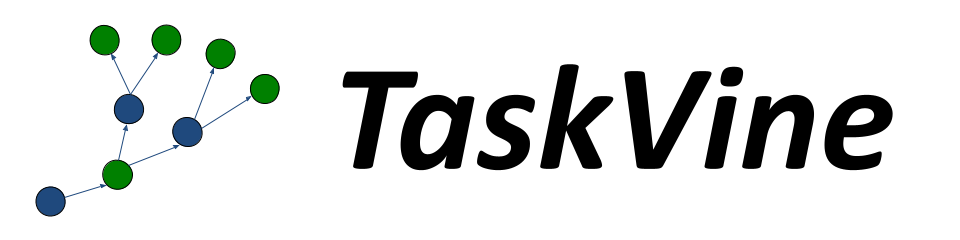

# TaskVine User's Manual

## Overview

TaskVine is a framework for building large scale data
intensive dynamic workflows that run on high performance computing (HPC)
clusters, GPU clusters, cloud service providers, and other distributed computing systems.
A workflow is a collection of programs and files that are
organized in a graph structure, allowing parts of the
workflow to run in a parallel, reproducible way:


A TaskVine workflow requires a manager and a large number of
worker processes.  The application generates a large number of small
tasks, which are distributed to workers.
As tasks access external data sources and produce their own outputs,
more and more data is pulled into local storage on cluster nodes.
This data is used to accelerate future tasks and avoid re-computing existing results.
The application gradually grows "like a vine" through
the cluster.


The TaskVine system is naturally robust.  While an application is running,
workers may be added or removed as computing resources become available.
Newly added workers will gradually accumulate data within the cluster.
Removed (or failed) workers are handled gracefully, and tasks will be
retried elsewhere as needed.  If a worker failure results in the loss
of files, tasks will be re-executed as necessary to re-create them.

The TaskVine software consists of a Core API that can be accessed
from Python or C on Linux, OSX, and other Unix-like platforms.
Simple applications can be written using the Core API directly
to submit and manage individual tasks and files.
Above that, TaskVine provides several high level APIs that can
be used to implement "serverless" computing, data reduction, and
graph management.  TaskVine can also be used as a plug-in distributed
execution layer for a number of workflow systems including
Parsl, Dask, Coffea, and Makeflow.


The TaskVine core API allows you to
declare file objects, and then declare tasks that consume them and
produce new file objects.  For example, this snippet
draws an input file from the Project Gutenberg repository
and runs a Task to search for the string "needle", producing
the file `output.txt`:

```
f = m.declare_url("https://www.gutenberg.org/cache/epub/2600/pg2600.txt")
g = m.declare_file("myoutput.txt")

t = Task("grep needle warandpeace.txt > output.txt")
t.add_input(f, "warandpeace.txt")
t.add_output(g, "output.txt")
```

Tasks share a common set of options.  Each task can be labelled with the resources
(CPU cores, GPU devices, memory, disk space) that it needs to execute.  This allows each worker to pack the appropriate
number of tasks.  For example, a worker running on a 64-core machine could run 32 dual-core tasks, 16 four-core tasks,
or any other combination that adds up to 64 cores.  If you don't know the resources needed, you can enable
a resource monitor to automatically track, report, and allocate what each task uses.

TaskVine is easy to deploy on existing HPC and cloud facilities.
The worker processes are self-contained executables, and TaskVine
arranges for all necessary task dependencies to be moved to workers,
making the system self-hosting.  Applications regularly consist of
millions of tasks running on thousands of workers.  Tools are
provided to easily deploy workers on HTCondor, SLURM, and Univa Grid Engine.

TaskVine is developed by the Cooperative Computing Lab at
the University of Notre Dame.  TaskVine is our third-generation workflow system,
built on our twenty years of experience creating scientific scalable applications in
fields such as high energy physics, bioinformatics, molecular dynamics,
and machine learning.

## Next Steps

- [Quickstart Instructions](quickstart)
- [Core API Tutorial](core)
- [High Level API Tutorials](highapi)
- [Running on Clusters](running)
- [Workflow Integration](workflow)
- [Logging, Plotting, and Tuning](logging)

## Further Information

For more information, please see [Getting Help](../help.md) or visit the [Cooperative Computing Lab](http://ccl.cse.nd.edu) website.

## Copyright

CCTools is Copyright (C) 2022 The University of Notre Dame. This software is distributed under the GNU General Public License Version 2. See the file COPYING for
details.
